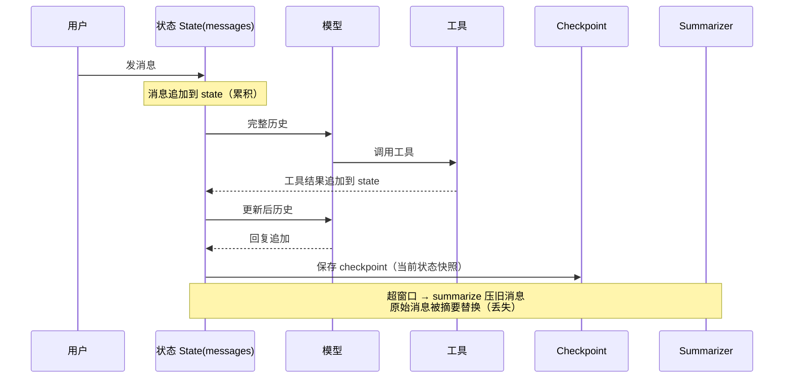
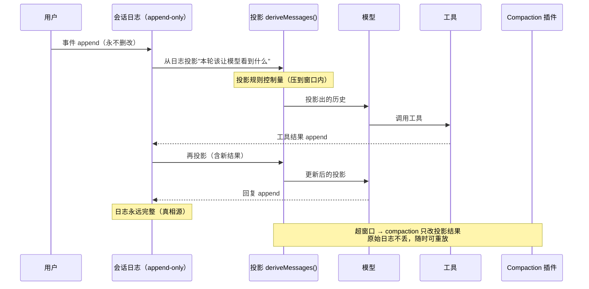
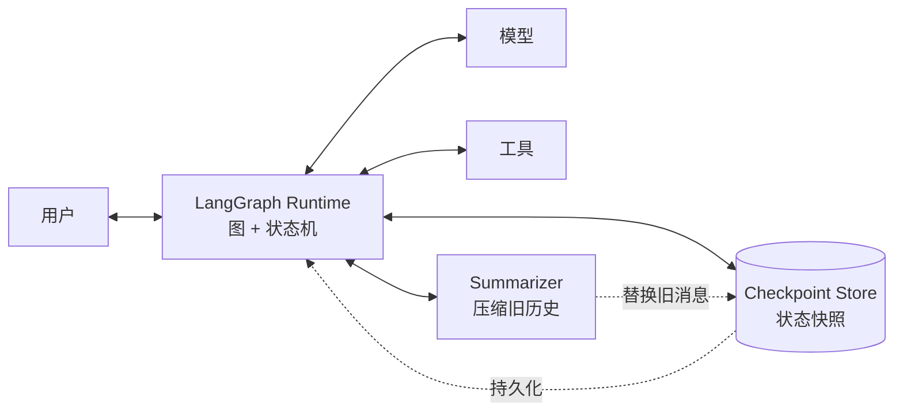
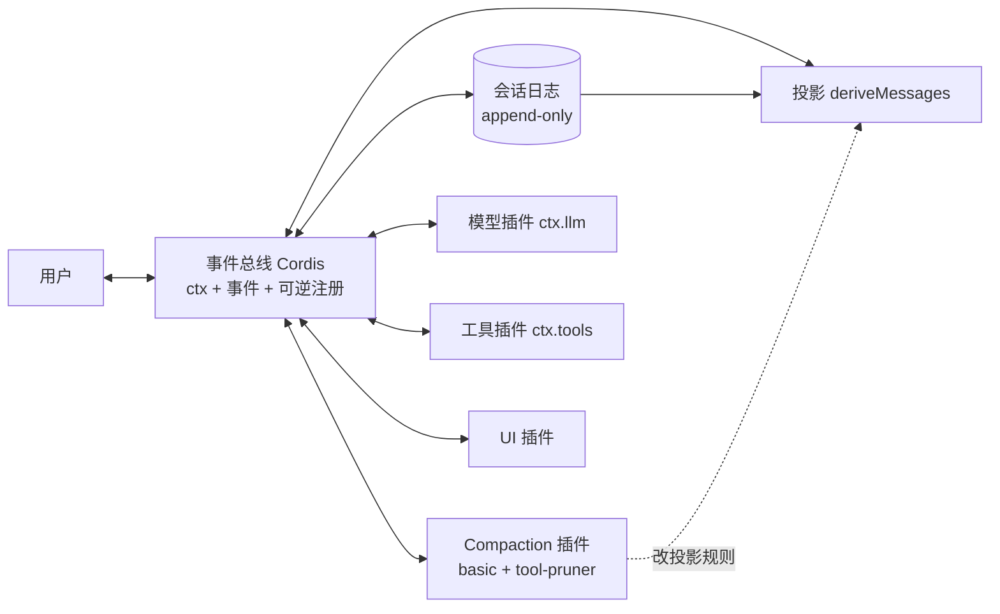

# DSH vs deepagents：架构对比图解

> 调研日期：2026-08-14。面向 deepagents 用户介绍 DSH 用。
> 核心一句话：**deepagents 的 context 是"状态"，DSH 的 context 是"从日志投影出来的"。**

---

## 0. 一句话结论

deepagents 是 **LangGraph 图运行时 + checkpoint 状态快照 + summarize 破坏性压缩**；
DSH 是 **Cordis 微内核 + append-only 会话日志 + 每轮投影 + 非破坏性压缩**。

两家都让模型看到"窗口内"的上下文，区别在：**历史怎么存（状态 vs 日志）、压缩是否丢原始、能不能回放审计。**

---

## 1. 单轮生命周期对比

### deepagents：状态累积



### DSH：日志 + 投影



**区别要点**：deepagents 的"状态"就是模型看到的东西 → 满了只能压、压了原始没；DSH 的"日志"和"模型看到的东西"是两层 → 日志随便长，投影控制窗口。

---

## 2. 模块交互对比

### deepagents 模块



### DSH 模块



**区别要点**：deepagents 是"一个运行时管所有"（LangGraph 图 + checkpoint + summarizer 是内建的）；DSH 是"一个薄内核 + 全是可替换插件"（连 agent loop 都是 `ctx.agentLoop` 插件，无特权核心）。

---

## 3. 长任务演进（第 1 / 10 / 50 轮）

| | deepagents | DSH |
|---|---|---|
| 存档 | checkpoint：当前状态快照 | 会话日志：每轮 append，完整 |
| 模型看到的 | 窗口内的消息 + 被压缩的摘要 | 投影规则算出来的窗口内版本 |
| 超窗口后 | summarize 压掉旧消息，**原始丢失** | compaction 只改投影，**日志永在** |
| 崩溃恢复 | 从最近 checkpoint 恢复（状态） | 从日志 resume，还能 **fork** 任意历史点 |
| 审计"它为什么这么判断" | ❌ 快照给不了 | ✅ 每步 raw 事件 + 投影规则可重放 |

### 示意：同一任务第 50 轮时的"档案"

**deepagents**（窗口满了，早期被摘要替换）：

```text
state = [摘要1(压掉第1-30轮), 第31轮..., 第32轮..., ... 第50轮]
         ↑ 原始对话细节已丢失
```

**DSH**（日志完整，投影只出窗口）：

```text
日志(磁盘) = [第1轮, 第2轮, ..., 第50轮]  ← 永远完整
                ↓ 投影
模型看到    = [摘要(1-30轮压缩), 31..., 32..., ..., 50轮]
              ↑ 压缩只改变投影，原始日志可随时重放
```

---

## 4. 差异总结

| 维度 | deepagents | DSH |
|---|---|---|
| 底座 | LangGraph（图 + checkpoint + persistence） | Cordis 微内核（事件 + 可逆注册） |
| 语言 | Python（另有 JS 版） | Node.js / TypeScript |
| context 本质 | 状态快照（累积） | 日志投影（重算） |
| 压缩 | summarize（破坏性，原始丢） | compaction 插件（非破坏，日志留） |
| 可审计/回放 | 弱 | 强（append-only 日志 + 投影） |
| 插件模型 | 覆盖/替换组件，不 fork | 一切皆插件，无特权核心 |
| 记忆 | pluggable backend（成熟接口） | 生态空白（第三方 memory-evolve 未验证） |
| 成熟度 | 生产级（LangSmith 工具链） | developer preview（0.1.0-rc.6，官方明示兼容性破坏） |
| 上手 | `uv add deepagents` | `npx @deepseek-ai/dsh web` |

---

## 5. 给团队的建议

1. **context 方向**：DSH 的"日志 + 投影 + 非破坏压缩"在可审计性/可复现性上是独一份——长任务复现、给客户解释决策的场景值得长期盯。
2. **记忆方向**：deepagents 有成熟的 pluggable backend 接口；DSH 是空白（dsh-memory-evolve 第三方、未验证），"全量注入 + 时间分层"路线生态无人做。
3. **行动**：现在不迁生产（DSH 还在 rc，官方明示 breaking changes）；持续跟踪，等正式版 + 生态验证后再评估。
