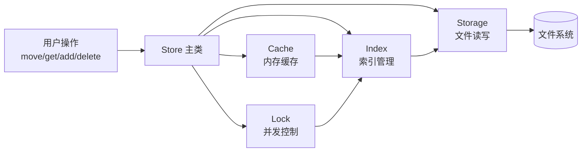
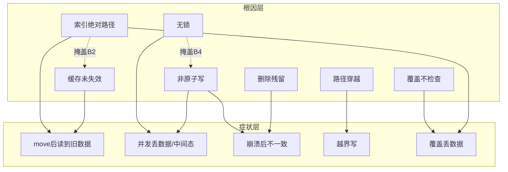
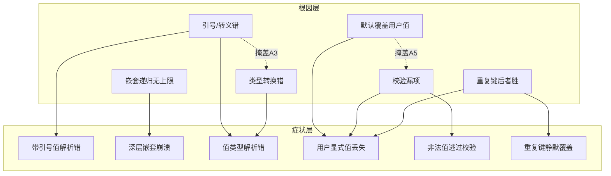
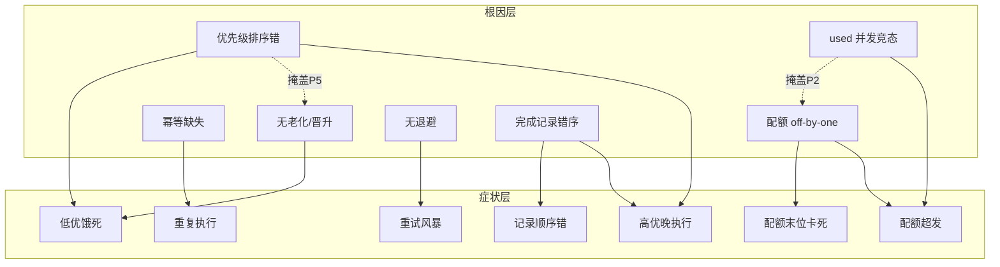
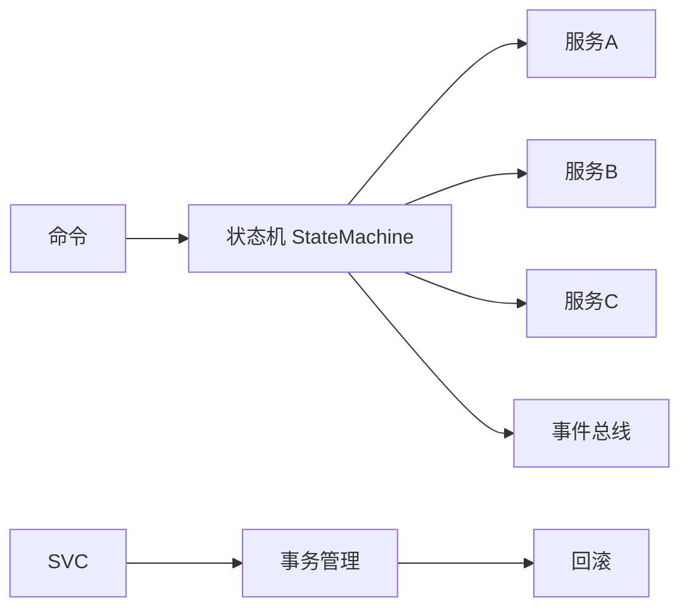
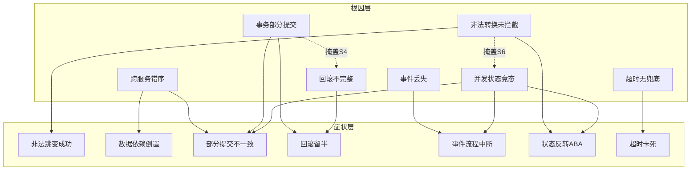
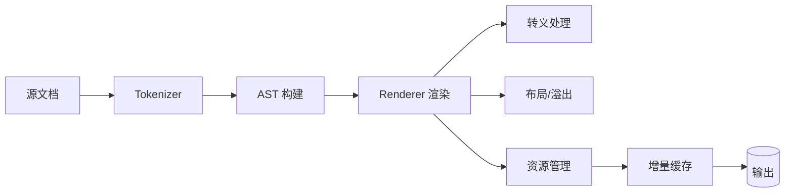
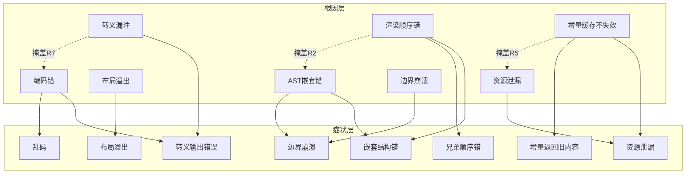

# MIND 评测任务设计（网状结构版）

> 目标：每道题 **5-20 个耦合 bug**（人类/AI 粗心架构出来的），bug 以**网状**方式耦合——根因与症状多对多、存在"掩盖"关系、修复顺序不唯一。模型必须建立系统心智模型，不能做"故障单扫描"。
> 用 VSCode/支持 mermaid 的编辑器打开本文件看渲染图。

---

## 0. 结构方法论：单链 → 网状

### 单链的毛病

```
单链: B1 → B2 → B3 → B4
```

修一个暴露下一个——线性、可预测。AI 一旦意识到链的存在，就"顺着修"，任务退化成**找链游戏**而不是**理解系统**。且单链有唯一解路径，测不出"模型有没有全局观"。

### 网状的构件

| 构件 | 定义 | 评测价值 |
|---|---|---|
| **根因节点** | 真实代码缺陷 | 待发现对象 |
| **症状节点** | 可观测的失败现象（业务测试断言） | 模型的线索 |
| **映射边**（bug→症状） | 哪个根因导致哪个症状失败 | 多对多 = 合力 |
| **掩盖边**（bug 掩盖 bug） | 根因 X 的错误输出恰好吞掉/伪装根因 Y 的症状——X 不修，Y 的症状不显现 | 模型修完一个才发现还有一个 |

### 网状 vs 单链的判定：5 条硬标准（每道题设计完自查）

1. **合力症状 ≥1**：至少一个测试失败是 2+ 根因的共同产物——修一个只让它部分变好
2. **掩盖关系 ≥1**：至少一个根因的症状在另一根因修复前不可见——不建全局观会漏
3. **无单链子图**：任何"顺着修"的最长根因链长度 < 总 bug 数——防止退化成找链
4. **修复推进可感知**：每次修复后至少一个症状变好或新症状显现——有反馈，防死胡同
5. **回归保护**：修对一个不能搞坏另一个已好的——双层检查点兜底

### 实现网状的手法（代码层面）

- **共享数据流污染**：多个模块读写同一数据结构，各自注入 bug，症状在数据流末端汇聚
- **前修后坏（掩盖）**：根因 X 的错误输出恰好是根因 Y 的正确期望输入——修 X 立即暴露 Y
- **合力叠加**：两个偏差同向（如两个 off-by-one 叠加差 2），单独看都在阈值内，合起来越界
- **双向依赖 + 双 bug**：模块 A 读 B 的输出、B 读 A 的输出，两边都有 bug 时症状取决于谁先触发

### 难度分级（机会次数不变）

| 任务 | bug 数 | 掩盖数 | 合力症状 | 机会次数 |
|---|---|---|---|---|
| T1 文档存储 | 7 | 2 | 4 | C（3 次） |
| T2 配置解析 | 6 | 2 | 2 | C（3 次） |
| T3 资源调度 | 7 | 2 | 3 | C（3 次） |
| T4 状态机 | 7 | 2 | 4 | C（3 次） |
| T5 渲染管线 | 8 | 3 | 4 | C（3 次） |

---

## T1「文档存储系统」— 7 个耦合 bug（网状）

### 模块架构



### 根因（7）

| # | Bug | 位置 | 隐蔽点 |
|---|---|---|---|
| B1 | 索引存绝对路径，move 后不更新 | index.py | 表面正常，数据流深处 |
| B2 | move 后 cache 未失效 | cache.py | 索引已修仍错 |
| B3 | index 读写无锁 | store.py | 单线程测不出 |
| B4 | add/delete 非原子（先写文件后更新索引） | storage.py | 需模拟崩溃 |
| B5 | move 目标含 `../` 路径穿越 | storage.py | 需路径校验 |
| B6 | move 覆盖同名不检查 | store.py | 边界场景 |
| B7 | delete 残留孤儿文件 | store.py | 需文件系统检查 |

### 网状 bug 图（根因 → 症状 + 掩盖）



### 合力与掩盖（实测确认）

- **掩盖 B1→B2**（审计确认）：索引路径错时 move 后 get 崩溃（FileNotFoundError）先行，缓存是否失效不可观测——修 B1 后 test_move_external_update_visible 仍红（B2 独立挡着），再修 B2 才绿
- **B1 影响双测试**：test_move_nested_preserves + test_concurrent_move_get 都随 B1 修复变绿
- **B3/B4 独立**：B3 索引无锁（并发 add 丢索引）、B4 add 非原子（崩溃残留半写文件）分别由独立测试暴露，修复互不影响
- **B5/B6/B7 独立**：路径穿越、覆盖保护、孤儿清理各自独立暴露
- 修复顺序不唯一，但 **B1→B2 存在顺序依赖**（必须先修 B1 才能观测到 B2 的存在）——这正是"不建全局观会漏 bug"的检测点

### 双层检查点

- **业务**：move 后数据完整（嵌套/覆盖/并发/崩溃恢复）、get 不返回旧数据（S1-S5 各一个断言组）
- **回归**：add/get/delete 基础、无孤儿文件、无越界写（R1-R3）

### 修复推进示例（验证"无单链"）

- 修 B1 → S1 仍红（B2 浮出）、S5 部分变好
- 修 B3 → S2 仍红（B4 浮出）
- 修 B4 → S3 仍红（B7）、S2 变好
- 只有 B1+B2+B3+B4+B6+B7 全修，5 个症状才全绿

---

## T2「配置解析系统」— 6 个耦合 bug（网状）

### 模块


### 根因（6）

| # | Bug | 位置 | 隐蔽点 |
|---|---|---|---|
| A1 | 引号/转义解析错（含转义字符串被截断） | lexer.py | 正常配置看不出来 |
| A2 | 深层嵌套递归无上限（栈溢出） | parser.py | 需构造深嵌套 |
| A3 | 类型转换错（`"false"`→True / 空串→0） | conv.py | 类型边界 |
| A4 | 默认值错误覆盖用户显式值（合并顺序错） | config.py | 用户值"丢了"像没配置 |
| A5 | 校验漏项（校验在默认合并前跑，默认值"修正"非法输入） | validate.py | 非法值被默认洗白 |
| A6 | 重复键静默后者胜 | parser.py | 需构造重复键 |

### 网状 bug 图



### 合力与掩盖（实测确认）

- **掩盖 A4→A5**（test_defaults_do_not_hide_invalid 检测）：全部 bug 时该测试通过——用户非法值 99999 被默认 8080 替换，看似没问题；修 A4（用户值优先）后 99999 保留 → A5 校验漏项浮出 → 测试转红；A4+A5 都修才绿
- **A1-A6 独立暴露**：转义、深层嵌套（1200 层递归爆栈）、类型判反、默认覆盖、校验漏项、重复键——各有专属测试，单独修复各自变绿
- **A1 修复影响面**：A1 修复让 6 个测试同时变绿（转义正确后整条解析链的值都对了）——它是解析层根因，A3-A6 的现象部分依赖 A1 修好后的正确值流

### 双层检查点

- **业务**：值正确性（引号/转义/类型/重复键）、深层嵌套不崩、用户显式值生效、非法值被拒
- **回归**：基础解析（无引号/简单键值）、默认值兜底、合法配置完整通过

### 修复推进示例

- 修 A1 → S1 好、S3 仍红（A3 浮出）
- 修 A4 → S4 部分好（A6 还挡着）
- 修 A5 → S4 仍红（A4 未修时默认仍覆盖）、S5 变好

---

## T3「资源分配调度器」— 7 个耦合 bug（网状）

### 模块


### 根因（7）

| # | Bug | 位置 | 隐蔽点 |
|---|---|---|---|
| P1 | 优先级比较符号错（低优先出） | scheduler.py | 需构造跨优先级队列 |
| P2 | 配额 off-by-one（最后 1 单位永远发不出） | scheduler.py | 需打满配额 |
| P3 | 幂等缺失（重复 submit 执行两次） | scheduler.py | 需重复提交 |
| P4 | 并发 used 计数非原子（低估/高估用量） | scheduler.py | 单线程测不出 |
| P5 | 低优先级无老化/晋升（无限饥饿） | scheduler.py | 需长时间运行 |
| P6 | 失败重试无退避（风暴） | scheduler.py | 需注入失败 |
| P7 | 完成记录顺序错（按提交序记） | scheduler.py | 需并发完成 |

### 网状 bug 图



### 合力与掩盖（实测确认）

- **掩盖 P1→P7**（审计确认）：排序错时 test_completion_order 失败可归因排序——修 P1 后 finished 仍按提交序（["low","high"]）→ 测试仍红（P7 独立挡着）；再修 P7 才绿
- **P2 与 P4 交错**（两条路都留尾巴）：P2 单线程配额末位发不出（used==10 而非 20）、P4 并发 used 丢更新（低估用量）——修 P2 后并发 S4 仍可能超发、修 P4 后单线程 S2 仍红。两个必须都修，交叉验证
- **P1/P3/P5/P6 独立**：优先级排序、幂等、饥饿门槛、退避各有专属测试
- 关键实现对：**P4 是读-改-写竞态**（读旧值→sleep 放大窗口→写回），P2 是 `>=` 边界错（拒绝恰好满额）——一个并发维度、一个确定性维度，修复交错是网状的核心体验

### 双层检查点

- **业务**：优先级正确、配额不超发、末位配额可用、幂等、并发安全、无饥饿、重试有退避、完成顺序正确（S1-S7）
- **回归**：单任务提交/执行/完成、配额边界内正常分配、重复提交合法（已幂等时）不崩

### 实现说明（供写 scheduler.py 时对照）

- P4 竞态要刻意"多算"：`used += units` 在锁外，高并发下读旧值累加 → 用量偏高
- P2 的 off-by-one 要独立：`if used + units > quota` 应为 `>=`，最后一个单位永远被拒
- 两个 bug 必须**可独立存在**（一个修了另一个还错），形成交叉验证

---

## T4「多服务状态机」— 7 个耦合 bug（网状）

### 模块



### 根因（7）

| # | Bug | 位置 | 隐蔽点 |
|---|---|---|---|
| S1 | 状态非法转换未拦截（INIT→DELETED 直跳） | statemachine.py | 需构造非法序列 |
| S2 | 跨服务调用错序（先调 B 用 A 未写的字段） | coordinator.py | 需服务间数据依赖 |
| S3 | 事务部分提交（A 提交 B 失败，整体半完成） | tx.py | 需注入服务失败 |
| S4 | 回滚不完整（漏了无事务服务的回滚） | tx.py | 需混合服务 |
| S5 | 事件丢失（总线丢事件，无重发） | events.py | 需注入丢事件 |
| S6 | 并发状态更新竞态（ABA） | statemachine.py | 单线程测不出 |
| S7 | 超时无兜底（服务超时流程永久卡死） | coordinator.py | 需注入超时 |

### 网状 bug 图



### 合力与掩盖（实测确认）

- **掩盖 S2→S3**（审计确认）：错序时 archiver 先失败 → validator 副作用不存在 → 部分提交不可观测（test_atomic_failure 通过）；修 S2（validator 先）后 validator 副作用残留 → test_atomic_failure 转红（S3 独立挡着）；再修 S3（run 只回滚已执行步骤）才绿
- **S1/S4/S5/S6/S7 独立**：非法转换、回滚漏通知、事件丢最后订阅者、并发 cas ABA、超时无兜底——各有专属测试
- **实现要点**：S3 修复 = 失败时只回滚**已执行**步骤（`_steps[:done]`），否则未执行的 notifier undo 会对空列表 pop 抛错中断回滚；S6 = cas 检查/更新加锁（读-改-写竞态）；S7 = 编排层捕获 TimeoutError 转 FAILED，状态不卡 VALIDATING

### 双层检查点

- **业务**：非法跳变被拒、跨服务依赖正确、整体原子性、回滚完整、事件不丢、并发状态一致、超时有兜底（T1-T7）
- **回归**：合法状态序列全流程、单服务操作、正常事件流

---

## T5「文档渲染管线」（最难）— 8 个耦合 bug（网状）

### 模块



### 根因（8）

| # | Bug | 位置 | 隐蔽点 |
|---|---|---|---|
| R1 | 转义漏注（`<>` 文本渲染成 HTML） | escape.py | 需含特殊字符输入 |
| R2 | AST 嵌套错（子节点挂错父） | ast.py | 需多级嵌套 |
| R3 | 渲染顺序错（兄弟遍历逆序） | render.py | 需多兄弟节点 |
| R4 | 布局溢出未处理（超长行不收缩） | layout.py | 需超长输入 |
| R5 | 资源未释放（图片/句柄泄漏） | resources.py | 需多次渲染观察句柄 |
| R6 | 增量缓存不失效（改文件仍渲染旧的） | cache.py | 需修改后重渲 |
| R7 | 编码错（UTF-8 声明与实际不符/BOM） | encode.py | 需非 ASCII 输入 |
| R8 | 边界输入崩溃（空文档/超大嵌套/极长单行） | ast.py | 需边界输入 |

### 网状 bug 图



### 合力与掩盖（实测确认）

- **R1-R8 各有专属测试**（每 bug 一个，审计逐一对号）：转义、编码、列表包 ul、列表顺序、兄弟顺序、长内容截断、资源释放、增量缓存、超大输入——独立暴露、独立修复
- **R2 与 R3 的结构互动**：R2 修复（列表分组 ul）后，列表内顺序恰好不再受 R3 影响（ul 内部直序渲染）——但 R3 仍在 text 段落场景独立暴露（test_sibling_order）；修复顺序不唯一，R3 必须单独修
- **实现要点**：R8 是海量行崩溃（>5000 tokens 抛 MemoryError），与 R4 超长单行（布局截断）是不同维度；R6 缓存按"内容"校验而非路径，文件变更后重渲

### 双层检查点

- **业务**：转义正确、嵌套层级正确、兄弟顺序正确、超长内容不溢出、资源无泄漏、增量渲染更新、非 ASCII 正常、边界输入不崩（O1-O8）
- **回归**：基础文本渲染、简单嵌套、正常长度输入、空文档不崩

### 修复推进示例（最多掩盖数，最难）

- 修 R1 → O1 仍红（R7 编码浮出）、O7 还红
- 修 R3 → O3 好、O2 仍红（R2 浮出）
- 修 R6 → O6 好、O5 仍红（R5 浮出）
- 三层掩盖各留一条尾巴，全部 8 根因修完才全绿

---

## 实现与验证

### 每题的落地物

```
benchmark/tasks/<id>/
├── task.json          # 难度/机会次数/任务描述(现象，不给根因)
├── feedbacks.json     # 每轮反馈序列（hint_roundN，可含症状变化提示）
├── check_biz.sh       # 业务检查点（症状断言，双层之一）
├── check_regress.sh   # 回归检查点（防搞坏，双层之二）
└── src/               # 任务代码（含全部 bug，按网状注入）
```

### 网状的自查清单（实现后逐题过）

1. 合力症状是否真的 ≥1 个被 2+ 根因挡着（修一个仍红）？
2. 掩盖关系是否真的成立（修掩盖者后，被掩盖者症状浮现）？
3. 有没有哪条"顺着修"的路径能一次猜中全部 bug？（有 → 需补掩盖/合力）
4. 每个症状对应的业务断言，是否在"根因未全修"时保持红、全修后转绿？
5. 回归检查点是否能在"修对一个搞坏另一个"时拦下？

---

## 实测审计结果（2026-08-18，自动化验证）

> 工具：`benchmark/tools/audit-bugs.py` —— 对每个 bug 单独修复（临时副本），跑业务测试，验证专属测试从红变绿；被掩盖 bug 先修掩盖者再验独立影响。

### 逐 bug 审计：35/35 全部确认真实生效

| 任务 | bug 数 | 审计 | 掩盖关系（实测） | 全修全绿 |
|---|---|---|---|---|
| T1 文档存储 | 7 | ✅ 7/7 | B1→B2 | ✅ 11 passed |
| T2 配置解析 | 6 | ✅ 6/6 | A4→A5 | ✅ 13 passed |
| T3 资源调度 | 7 | ✅ 7/7 | P1→P7 | ✅ 10 passed |
| T4 状态机 | 7 | ✅ 7/7 | S2→S3 | ✅ 11 passed |
| T5 渲染管线 | 8 | ✅ 8/8 | 无（R2/R3 结构互动） | ✅ 13 passed |

### 当前（全部 bug 存在）业务失败分布

| 任务 | 业务失败 | 回归通过 |
|---|---|---|
| T1 | 8 | 3 |
| T2 | 6 | 4 |
| T3 | 7 | 3 |
| T4 | 6（S3 被掩盖不计） | 5 |
| T5 | 9 | 4 |

### 被掩盖 bug 的验证逻辑（关键）

- **T1 B2**：修 B1（索引更新）后 test_move_external_update_visible 仍红（缓存旧值挡着）→ 再修 B2 变绿
- **T3 P7**：修 P1（排序对）后 test_completion_order 仍红（finished 提交序挡着）→ 再修 P7 变绿
- **T4 S3**：修 S2（顺序对）后 test_atomic_failure 仍红（部分提交残留挡着）→ 再修 S3 变绿

这三个被掩盖 bug 是评测的**核心检测点**：模型如果只修"可见症状"（如先修 B1/P1/S2）而不同时修被掩盖者，业务测试仍红——逼模型建立全局心智模型，而不是"修一个看到一个"。
